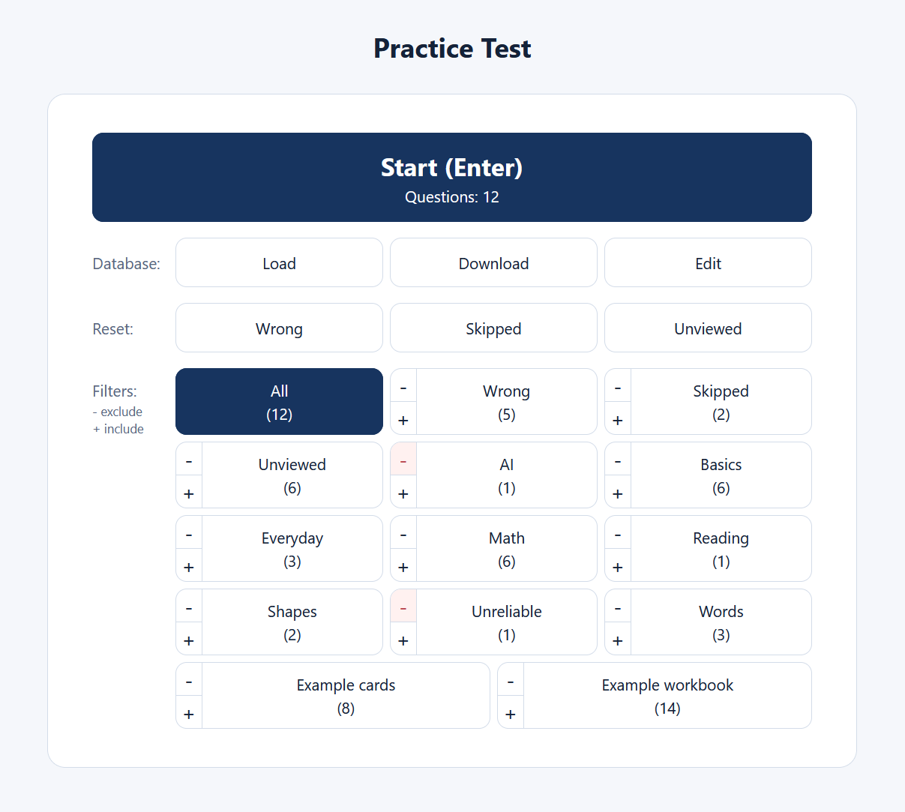
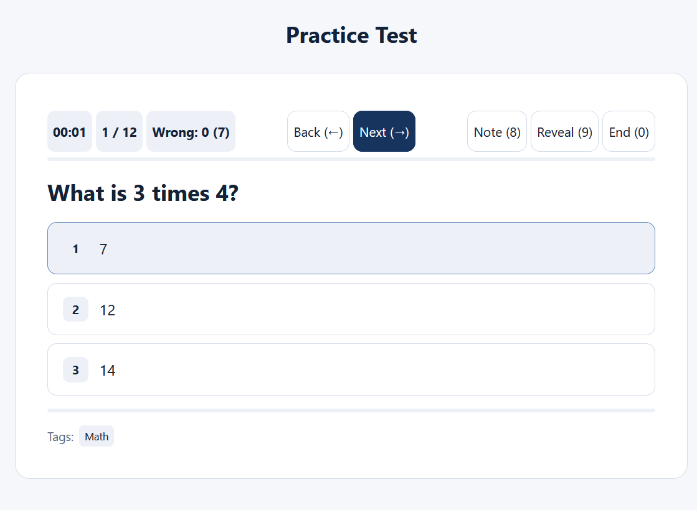
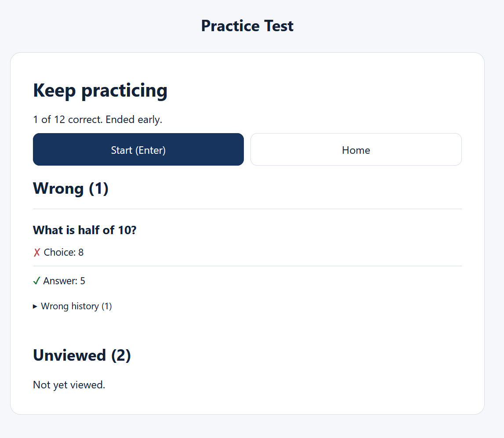
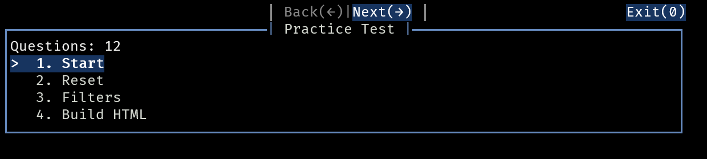
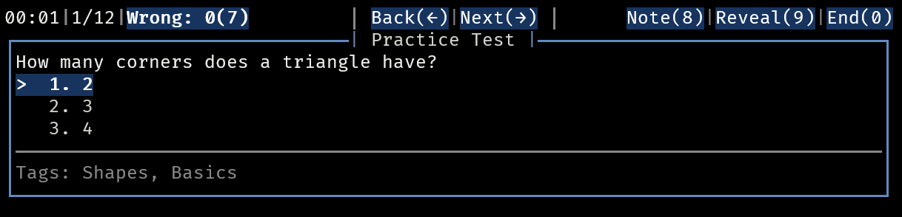
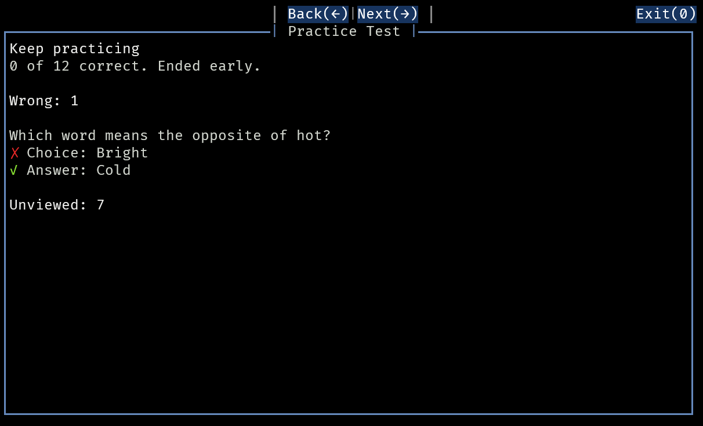

# practice
A simple app to practice multiple choice questions in the terminal or in a web browser.

Both `practice.html` and `practice.py` are standalone and do not need each other, and both can be used with either the mouse or keyboard.

Usage instructions provided in the relevant files.

